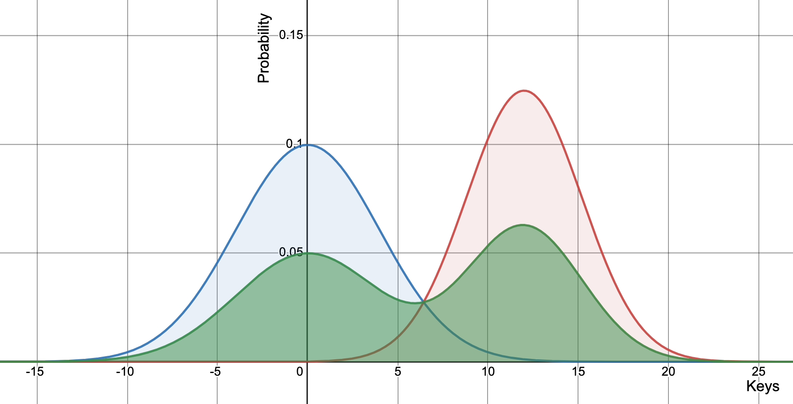

[[_TOC_]]

# Caching Serie 02 - Optimizing bounded cache eviction policies

## Introduction

This article is the part 2 of the Equativ caching blog series. In the previous article we've seen the theory around access patterns, the different challenges around caching from the weaknesses some of these access patterns can BLABLA

If you haven't seen it, please have a look before diving into this second part because we are going to reuse some technical jardon introduced in part 1.    

Here we are going to implement different logics in order to, step by step, evolve from a simple LRU cache to more complex implementations that perform better in a number of scenarios (better meaning more cache hits for the same memory footprint).

The goal is not to come up with single general purpose solution that will outperform everyting in all situations, firstly because that would not be possible given how contextual caching is and will remain, but rather to make iteratively evolve our implementation base on the limitations we will be facing.

Caching has been a hot research topic in computer science for decades and is still be today. Many different paper presenting cache eviction policies were published. However, it wouldn't really help us get a deep understanding by simply implementing a bunch of them and comparing their results, since they were all developed in different contexes, by different people, and many use very specific heuristics and it would make no sense to try coming up with a general explanation. Instead, we will take a few of them and compare their results with what we came up ourselves at the end of this article, to benchmark how good or bad our reasoning was and if our new policies can compete with industry proven ones.

## The benchmark setup

In order to be able to move on from one implementation to another, we need to be able to assert if a given implementation correctly answered the given problem. For this reason, we must:
- Frame the implementations so that we compare apples to apples.
  - All implementations benchmarked must be true O(1) (no binary tree; no logn, ...)
  - Size constrain will be the number of entries. It means that memory overhead per entry is not taken into account nor is the size taken by probatory entries (where only the key is retained, no the associated value).    
  We will make sure however we mention specificities that imply more memory usage.
- Benchmark against a variety of nature of input data

### Benchmark generators

At the end of this article we will be using a few real world datasets to compare the different implementations we came up with in "real world" cases, however, these datasets are generally a mix between different access patterns, making it difficult to conlude on the performance of some implementation against a specific access pattern.
Instead, what we propose is to generate input data using what we called a **generator**.

Let's see what it looks like with some code.

A generator must implement the interface `IGenerator<T>` and implement `T Generate()`. An important implicit rule for a generator is to be deterministic, so that generated values when benchmarking different cache implementations are the same.

For our benchmark, we'll be using `long` key, as it will allow us to play with a relatively simple key type without loosing much cardinality. 

Two basic generators we can start with are:
- `SparseLongGenerator`: Generates random (but determinist) longs in a unfirmorn way, given some min / max bounds
- `GuaussianLongGenerator`: Generates random (but determinist) longs given a set mean and standard deviation

Then we can implement some higher level generators:
- `SwitchableGenerator<T>`: Swaps between several generators every N generated values. Useful for creating "true" scan access patterns for instance.
- `MultimodalGenerator<T>`: Randomly picks between several generators for every generated value. Useful for creating simple mixed access patterns like a bimodal guaussian pattern for instance.

Here is an example: 
Let's say we have two Guaussian (also known as normal) distribution:
- A with mean 0 and standard deviation 1 `A = new GuaussianLongGenerator(µ: 0, σ: 1)` (in blue on the graph)
- B with mean 12 and standard deviation 0.8 `B = new GuaussianLongGenerator(µ: 12, σ: 0.8)` (in red on the graph)    

Then we can generate a bimodal guaussian distribution with `new MultimodelGenerator(A, B)` (in green on the chart)
 

With these different generators, we should be able to artifically reproduce some common access patterns in an comprehensive, reproducible and scalable manner.

## Simple cache eviction with LRU

### Implementation

Excalidraw
Some code

### LRU main weakness

Chart of LRU with a scan, being flat as the cache size increases

## Addressing scan vulnerability of LRU with SLRU and MSLRU

What it solves
MySQL https://medium.com/@arpitbhayani/what-makes-mysql-lru-cache-scan-resistant-a73364f286d7
Known solution
aaa

## Generalization of MSLRU with LU (Least Used)

## Addressing LU's aging problem with LUDA

## Preventing count overflow with LFU and LFURA

Side benefit of LFURA -> When there entries expires, it participate naturally to their eviction

## Improving tracking efficiency with PLUDA and PLFURA

## Other solutions (ARC, LIRS, ...)

## Wrap up

### Benchmark with some real data

### Conclusion

Source code