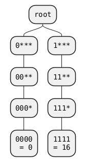
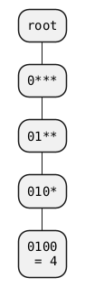
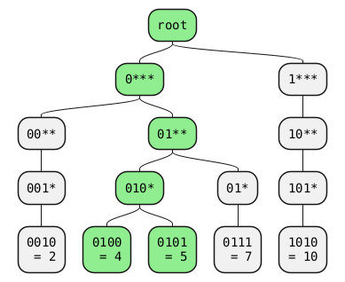

Min max 4 levels = 2^4 = 16 values

Insert delay of 4ms

Inserting another delay of 4ms results in no new node

# Taking elapsed time into account

# Finding delays between two timestamps

Compare timestamps min max with children bits

What about value 2? Why is it left out? -> onto wrapping

# Wrapping