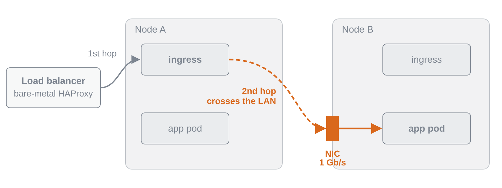
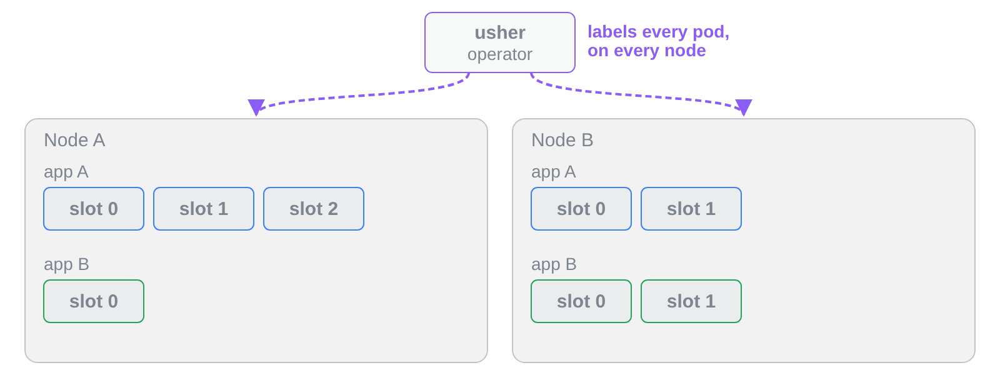
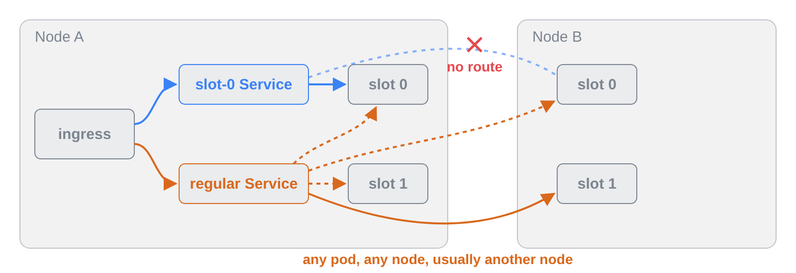
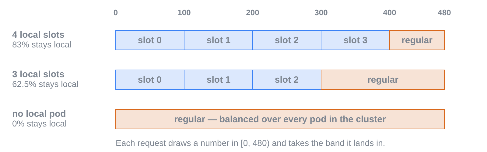
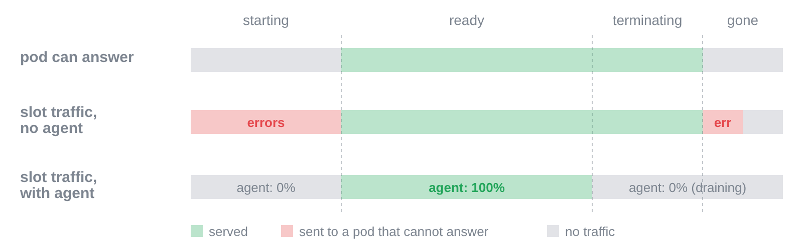
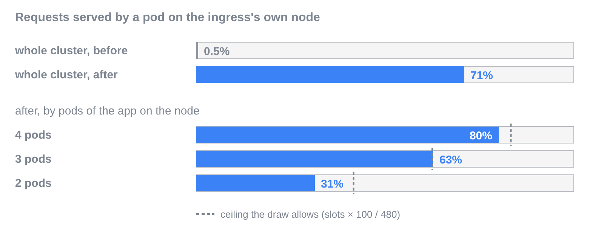
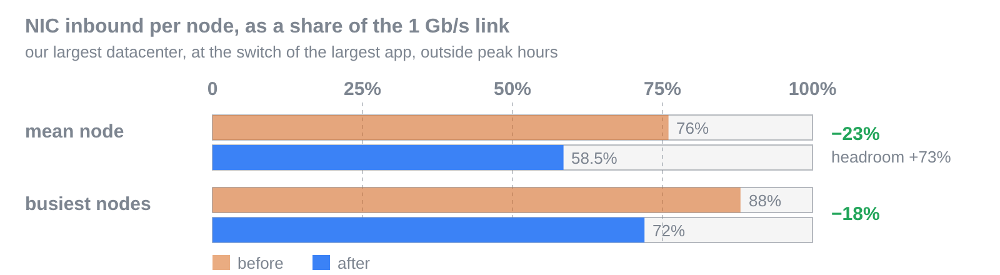

# A hop that did not need the network

Some of our apps run on bare-metal Kubernetes clusters whose nodes have 1 Gb/s network cards. As traffic grew, those cards became the limit: at peak, the average node was receiving three quarters of what its link can carry, and the busiest ones were close to full. The usual answer is new hardware. Before buying it, we looked at what the bytes on those links actually were, and found that about 30% of the inbound traffic was a hop we had added ourselves.

Every request reaches a cluster through two hops. A pool of hardware load balancers spreads requests evenly across the nodes, where an ingress controller runs on every node. That is the first hop, and it is unavoidable. The ingress then forwards the request to one of the application's pods, chosen among all the pods of the cluster. With hundreds of nodes, the pod it picks is almost never on its own node, so the request crosses the network a second time, and the response comes back the same way.



That second hop, request and response together, was 29% to 33% of the inbound traffic on our three largest datacenters at peak. If the ingress could hand the request to a pod sitting on its own node, that traffic would never touch the card.

# What Kubernetes gives you, and why it was not enough

Kubernetes has a setting that sounds like exactly this. A Service with `internalTrafficPolicy: Local` only routes to endpoints on the caller's node. Applied to the application's main Service, it keeps every request local, but it is all or nothing. A node with no pod of that application drops the requests it receives, and since the load balancers give every node the same share of traffic, a node running one pod sends that pod as much traffic as four pods share on the next node. Topology-aware routing has the right shape, preferring nearby endpoints with a fallback, but it works at the granularity of a zone, and a bare-metal datacenter is a single zone. Newer Kubernetes releases add node-level preferences to `trafficDistribution`, with the same all-or-nothing behaviour per node.

What we wanted was a preference: keep a request on the node when a pod is there, spill over to the rest of the cluster otherwise, and keep every pod evenly loaded. We assembled it from three mechanisms that already existed.

# Prefer local, spill over the rest

## Give each pod a number on its node

The first problem is naming "a pod of this application on this node" in a way a Service can select. A small in-house operator, usher, watches the application's pods and stamps each one with a label, `eqtv.io/local-slot`, whose value goes from 0 to 3. The number is unique within a node for a given application: two pods of the same application on one node never share a slot, while slot numbers repeat across nodes and across applications. On a given node, "slot 2 of this application" now names exactly one pod.



## One Service per slot, restricted to the node

For each slot number, we create a Service selecting the application's pods with that slot label, and set `internalTrafficPolicy: Local` on it. That Service resolves to the same address on every node, but each node's kube-proxy only routes it to its own local pod. When the ingress on node A calls the `slot-0` Service, it can only reach node A's slot-0 pod, never node B's. The application keeps its regular Service, which still reaches any pod in the cluster.



```yaml
apiVersion: v1
kind: Service
metadata:
  name: my-app-slot-2
spec:
  internalTrafficPolicy: Local      # only route to an endpoint on the caller's node
  publishNotReadyAddresses: true    # keep a restarting pod behind its slot (see below)
  selector:
    app.kubernetes.io/instance: my-app
    eqtv.io/local-slot: "2"
  ports:
    - { name: http, port: 80, targetPort: 8080 }
    - { name: haproxy-agent, port: 8081, targetPort: 8081 }
```

## A weighted draw in the ingress

Our ingress controller is HAProxy, which lets us add raw configuration to a backend. We declare one extra server per slot Service, then, for each request, draw a random number between 0 and 480. Each local slot that is up claims a band of width 100, its weight, at the start of that range. If the draw lands in a slot's band, the request goes to that slot's Service and stays on the node; past the last band, it falls through to the regular servers and is balanced across the whole cluster.



With four local pods, the bands cover 400 of 480, so about 83% of the node's requests stay local. Each missing pod hands another 100/480 to the rest of the cluster. That spill-over is deliberate: a node with four pods and a node with none receive the same traffic from the load balancers, and the overflow is what tops up pods on lightly populated nodes and serves nodes with no pod at all. The range is fixed at 480, four slots at a weight ceiling of 120, so that the same weight means the same share on every node.

```text
http-request set-var(txn.slot_end0) srv_weight(slot0)
http-request set-var(txn.slot_end1) srv_weight(slot1),add(txn.slot_end0)
http-request set-var(txn.slot_end2) srv_weight(slot2),add(txn.slot_end1)
http-request set-var(txn.slot_end3) srv_weight(slot3),add(txn.slot_end2)
http-request set-var(txn.range) int(480)
http-request set-var(txn.range) var(txn.slot_end3) if { var(txn.slot_end3) -m int gt 480 }
http-request set-var(txn.local_pick) rand(65536),mul(txn.range),div(65536)
use-server slot0 if { var(txn.local_pick),sub(txn.slot_end0) -m int lt 0 }
use-server slot1 if { var(txn.local_pick),sub(txn.slot_end0) -m int ge 0 } { var(txn.local_pick),sub(txn.slot_end1) -m int lt 0 }
# slot2, slot3: same shape
server slot2 my-app-slot-2.my-namespace.svc.cluster.local:80 \
  disabled backup weight 100 slowstart 60s check inter 2s agent-check agent-port 8081 agent-inter 2s
```

`srv_weight` is read on every request, so a weight change applies immediately, without a reload. The slot servers are declared `disabled backup`: they take no part in normal balancing and are only reached through `use-server`.

# The catch: readiness moves into HAProxy

A Service normally hides pods that are not ready. The slot Services publish not-ready addresses on purpose: a restarting pod stays behind its slot, so HAProxy's health check is refused immediately instead of timing out on a dropped connection. The price is that Kubernetes readiness no longer protects slot traffic. During a rollout, HAProxy could send requests to a pod that is still warming up, or to one that has started shutting down.

HAProxy's agent check closes that gap. Our in-house .NET SDK already exposed an agent on port 8081, which HAProxy polls every two seconds and which reports the pod's weight; we used it to compensate for heterogeneous hardware. The agent now also reports the pod's lifecycle: 0% while it starts, 100% once ready, and 0% again as soon as shutdown begins. The application keeps serving for five seconds after that, more than two agent checks, so HAProxy has drained it before its ports close.



# What it bought us

How much an application can keep local depends on one thing: how many of the ingress nodes also run one of its pods. Our largest application runs on almost every node that receives traffic, so it is where the gain shows. In our largest datacenter, the share of its requests served on the ingress's own node went from about 0.5%, one node in two hundred, to 71%. Nodes with four of its pods keep 80% of their requests local, close to the 83% the draw allows.



On the network cards, switching that one application over cut the average inbound traffic per node by 23% in that datacenter, which grows the free capacity on each link by 73%. The two other large datacenters dropped by 26% and 27%. These figures were taken outside peak hours, when traffic is lower.



To know whether it keeps working, we compute two shares from metrics we already had. The measured one comes from HAProxy's backend counters: requests sent through `use-server` are not load-balanced, so one minus the load-balanced share is the local share. Retries count as load-balanced too, and during an overload they dragged the result below zero until we subtracted redispatches. The expected one comes from the number of ready pods on each node, capped at four, times 100/480. An alert fires when the measured share stays below half of the expected one for fifteen minutes. Over a week of data on every datacenter and application, the ratio never went below 0.69, including applications whose expected share is around 1%.

# The limits of the design

This is a preference bolted onto Kubernetes, not a feature of it, and it shows in a few places.

There are at most four slots per node and per application. Four is what our nodes can host for our heaviest applications, and the HAProxy snippet declares one server per slot. A fifth pod on a node gets no slot and only receives traffic through the spill-over.

Locality also has a ceiling, on purpose. Even a node with four pods sends 17% of its requests elsewhere, and an application that runs on a handful of nodes gains almost nothing, because on a node without its pods every request still crosses the network. The technique pays off for applications spread over most of the nodes that receive traffic.

Readiness probes no longer gate slot traffic. Pods still have them, and they still govern the regular Service, but the local path trusts HAProxy's checks and the application's agent. An application has to implement that agent, including the 0% answer during startup and shutdown, before it can be routed this way.

Finally, it adds moving parts: an operator that has to keep labelling pods, four extra Services per application, and a block of HAProxy configuration per backend. Each one fails safe, since a pod without a slot label is still served by the regular Service, and a slot whose pod is gone fails its check and drops out of the draw. They are still things to deploy, monitor and explain to the next engineer, which is what this article is for.

It also relies on our setup: an ingress controller on every node, load balancers that spread traffic evenly across nodes, and a network card as the bottleneck. If cross-node traffic is expensive in your clusters, whether in bandwidth, latency or cloud egress, the same three pieces apply.
