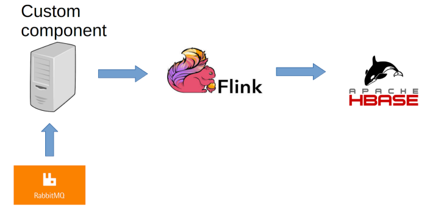
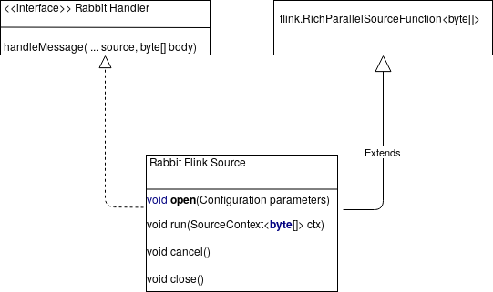
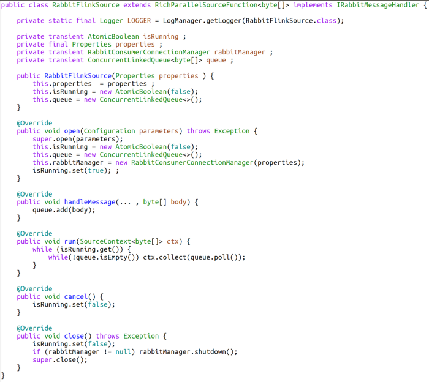
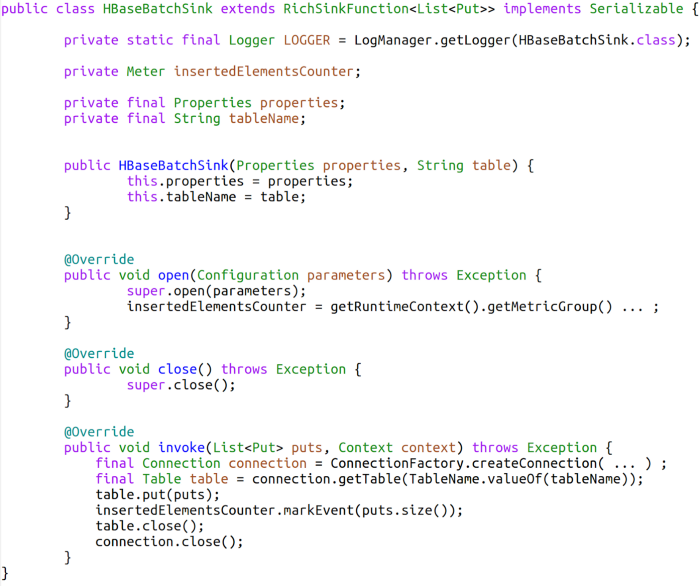

Published 17/12/19 the on [Medium](https://medium.com/smart-ad-monetization-platform/custom-sources-and-sinks-with-flink-ae00e8502b0)

[[_TOC_]]

# Custom sources and sinks with Flink

Big data applications used to be, a long time ago, batches based on map-reduce. Some business domains, for instance, advertising or finance, need streaming by nature. Flink arrived in 2011 as a streaming engine, with no hidden micro-batches, a low- latency and real event management. But Flink, and streaming in general, come with concepts that are not easy to understand at first sight (windowing for instance). This article will not paraphrase the documentation (the official website is very good), but it is about the next step, a good use case for data teams to start using Flink in production.

This article is a guide to start a simple application with Flink. We assume the reader is already familiar with the general concepts of Flink, HBase, and JMS (Rabbit MQ is the source we used for that article). We provide technical feedback on the elements to start with, for a simple stateless project.


## Flink for simple needs: data transfer

Our goal in this part is to provide feedback about custom sources and custom sinks and discuss Flink for simple cases. Here is the technical use case we will discuss.



A custom component reads data from Rabbit MQ queues. The main purpose of this component is to pool and unpool machines on the fly. This custom component consumes messages, it is then the Flink source. Flink reads the content of the messages it receives, group them per id (contained in the message itself) and then writes data into HBase, our sink. There is no other complicated business mapping, just plain reading and mapping into puts for HBase insertions. We used Flink 1.8, there was no off the shelf HBase sink.

The general algorithm is quite simple :

1. The custom source reads JMS messages as `byte[]` (one `byte[]` per message)
2. Those bytes are passed into mappers that deserialize them, find the id of each message, and make the put to apply to HBase (one put per message, the row key depends on the id of the incoming message)
3. A global window is defined to group all messages into batches (10 seconds). Local windows depend on the key of each incoming element, but global windows group all the messages into the same group, depending on the window type. We used a global window based on time.
4. HBase is our sink. So, for all the puts that arrived in the last 10 seconds, a connection to HBase is then opened, puts are batched, and the connection is closed.

### Defining a custom source

We will use the Rabbit MQ source as an example to explain how you may implement a custom source.

Rabbit MQ consumer has a method looking a lot like handleMessage(…, `byte[] body`) (we use a generic name for the method. First parameters are messaging properties, the part we need is the body).



To define a custom source, a simple solution would be to extend RichParallelSourceFunction (serializable), and the four methods Flink needs:

Open: In general, it is necessary to perform all the initializations that the core code will use (connection for instance). In this specific case, it opens the connection to Rabbit MQ. The constructors only contain data to pass to the open method, and should not start any connection.
Run: process an incoming message. The structure of the code is generally an infinite loop waiting for messages and adding them into the source context (that has been passed as a parameter).
Cancel: because the run is an infinite loop, the cancel method defines a way to stop the loop. We chose to use a (transient) atomic boolean set in open method to true, read in open method as a condition for the infinite loop, and set to false in cancel method.
Close: close any connection or flush any buffer opened in the open method.
The complexity is that the run method processes messages from a flink point of view, whereas handleMessage processes messages from a Rabbit point of view. Each method may not call the other one. So we used a synchronized FIFO. Code looks like:



### Flink and the serialization

Flink is distributed over a cluster to deal with parallelism or error management. For instance, the framework uses a parallelism parameter to have multiple instances of the same mapper over the cluster. For this paradigm to work, classes managed by Flink are serializable (especially any implementation of a RichParallelSourceFunction). Flink will then serialize some instances, pass them to some nodes in the cluster, and then rebuild “copies” of it. The constructor of the class, and then the open method is called on the destination JVM. Some instances variables are local to the current machine, such as the current connection to a database, and should not be shared. Other elements, such as JDBC properties to rebuild those connections, have to be shared so that another connection may be opened on another machine. It means that any local object, for instance, any connection to a database, or to Rabbit MQ for our specific case, cannot be serialized but the data it depends on should be serializable.

### How to avoid managing long run sessions

Let us now consider our sink, that is, an HBase output. First of all, a way to implement a sink is to extend RichSinkFunction, and then define three methods :

Open: as for a source, opens any element necessary in the sink (connection for instance, although we will discuss this point)
Close: as for a source, closes any opened element managed by the class (for instance, a connection)
Invoke: once messages are processed by flink and then ready to be pushed, this method is called. It generally uses the elements opened in the open method.
Putting data as soon as it arrives raises the question of long-run sessions. It means we would have to manage the reopening of a closed session in the invoke method. But, we chose to use a global window (windowAll), that groups all the incoming messages into batches of 10 seconds. In the invoke method, we then apply all the puts. Code is:




Monitoring is performed via instances of Meter. The idea is to export them to Grafana to compare incoming JMS counters with output elements. There is nothing more in the code than defines the metrics and updates them.

## Getting ready for production

The issues this code raises are simple: what happens when a source crashes, when HBase fails, or when the code fails to insert into HBase?

First obvious step is the detection of this kind of event. Standard monitoring deals with it. We recommend :

The use of metrics to compare source and sink volumes (for instance to test in practice the duplication of elements and the loss of elements with the same id). The raw data on the volumes allow a fair view on the load, hence the processing speed.
The monitoring of flink metrics, for instance, the ones provided via JMX. It includes frequency and size of the checkpoints (this use case does not imply checkpoints, but it is still something to keep an eye on), the job managers cpu load and memory, the task managers cpu load and memory, the threads counts.
Relaunching a failed streamer raises the question of idempotency. Any streaming solution insists on the ability of a system to manage the insertion of the same data. As we mentioned, our destination is HBase, and we insert data based on a logical id. Any “replay” of the same data would mean putting the last version of the data. For our specific case, this is not an issue, but the next article will discuss that point.

Last but not least, not only using YARN sessions is a better option than standalone runs, but it is also simpler to deal with. Our solution was to run a specific session per business case, with a global YARN queue (for all the flink jobs). Its definition means allocating some specific YARN resources and here is an example :

```bash
./flink/bin/yarn-session.sh -n 4 -jm 4096m -tm 8192m -s 4 -d -nm “our flink use case” -qu root.flink -z flinkCase
```

It means that we allocate 4 YARN containers (-n), the dedicated YARN queue is root.flink, the job container has 4096 Mb of memory, the task manager has 8192 Mb of memory, 4 slots are available (-s), the name for the yarn session displayed on YARN is “our flink use case”.

The important part for sessions not to be mixed is the `-z flinkCase`. The use of that zookeeper namespace means that two sessions will have zookeeper sub-paths, and then will not interfere. Finally, for any flink run command, we just use the same configuration (`-z flinkCase`) for the job to find the session it is allocated in.

## Conclusion

This first article is about a simple use case: a map that reads a custom source to write a custom sink, without any state management. Elements to focus on are:

Data quality with special care on failure detection and management. It means dealing with the source of failures (connection to sources or sinks may fail and a mechanism to deal with session loss is mandatory), data loss monitoring and detection (use of dedicated metrics monitored with a specific tool, such as Prometheus and grafana), and dealing with input quality.
The source management is especially important for idempotency, because of the ability to read from it again and again. In general, the ability to start, stop, restart the application, even after a long delay, is not a feature to add at the end of the development, but should really be considered at the earliest stages of the process.

---

We are currently hiring Data Scientists and Machine Learning Engineers in our Paris office! Come and check out our open roles on our [careers site](https://equativ.com/careers) and do not hesitate to contact us there or on Medium.